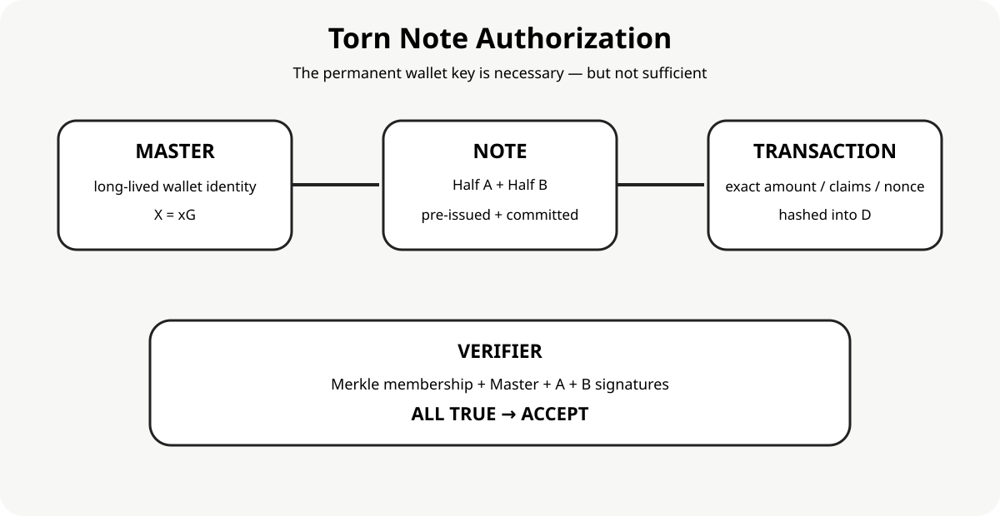
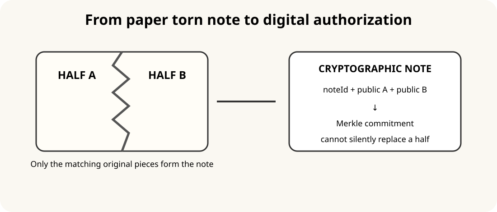

# Torn Note Cryptography

> **An open research question: can authorization depend on both a long-lived identity and a pre-issued, consumable authorization object—so that the identity key alone is not enough?**

<p align="center">
  
</p>

**Status:** exploratory cryptographic research prototype. Not production-ready, not formally proven, and not claimed to be novel.

Torn Note is an attempt to investigate a particular authorization problem. The purpose of this repository is not to sell a finished protocol or defend an idea at all costs. It is to make the question understandable, make a candidate construction concrete, and invite other people to find its weaknesses—or show that a simpler established design is better.

## Why does this authorization protocol exist?

A digital signature usually answers a simple question:

> **Does the holder of this private key authorize these exact bytes?**

That is a powerful primitive. But in some systems, we may want a second question answered as well:

> **Is this authorization using a specific object that was legitimately issued in advance, and is that object still allowed to be used?**

Consider a wallet, account, device, or identity whose long-lived key is compromised. If possession of that key is sufficient for every future action, an attacker may be able to authorize arbitrary transactions until the compromise is detected and the key is revoked or replaced.

Could a system instead require the identity key **and** a separate, pre-issued authorization object for each permitted use? Could the object be bound to the exact transaction and consumed once? Could a verifier reject invented objects, even if an attacker can generate perfectly valid keys and signatures for them?

That is the problem Torn Note explores.

This is not a claim that ordinary signatures are broken, or that adding more keys automatically makes a system safer. Multi-signature schemes, threshold signatures, hardware-backed keys, capabilities, signed registries, transaction policies, and one-time tokens already address overlapping problems. A central research question is whether Torn Note provides a meaningful property beyond these known approaches—or whether one of them solves the problem more simply.

## The idea: a note that has to be torn back together

<p align="center">
  
</p>

Imagine a valuable paper note torn into two uniquely identifiable pieces. The wallet also has a permanent identity key.

- The **master factor** represents the long-lived identity.
- **Fragment A** is one part of a particular authorization note.
- **Fragment B** is the other part of that note.
- The **note ID** identifies that pre-issued note.
- An **inventory commitment** records which notes were legitimately issued.
- The **transaction digest** binds authorization to the exact action.
- **Spent state** records whether that note has already been used.

The intended policy is that the master factor alone is insufficient, either fragment alone is insufficient, and a fabricated pair of fragments must not become authorized merely because an attacker can create valid cryptographic keys for them.

The important idea is therefore **not simply “require three signatures.”** It is the combination we want to investigate:

1. authorization factors are distinct;
2. the note is issued and registered before use;
3. authorization is bound to a specific transaction;
4. the note has a defined one-time-use lifecycle;
5. the verifier can check these conditions under an explicit trust and state model.

Whether these ingredients actually deliver a useful security property is precisely what needs independent scrutiny.

## What is the goal?

The goal is to answer four questions rigorously:

1. **Security:** Can an attacker who lacks one required factor nevertheless obtain acceptance, for example by substituting keys, inventing a note, replaying an old authorization, or exploiting verifier state?
2. **Specification:** Can the protocol be described precisely enough that two independent implementations agree on the same messages, encodings, state transitions, and accept/reject decisions?
3. **Value:** Does pre-issued inventory membership provide a real benefit compared with conventional multi-signature, threshold-signature, hardware-backed, or policy-based approaches?
4. **Feasibility:** If the idea survives those tests, is there a sound route to a threshold-signature or privacy-preserving variant? If it fails, can we identify the smallest counterexample and learn from it?

**Success does not mean proving the original idea right.** A clear break, a proof that a simpler construction dominates it, or a finding that the idea adds no useful security would all be valuable research outcomes.

## What the current prototype models

At a high level, each pre-issued note has a unique identifier and two fragment public keys. The issuer commits the allowed notes into a Merkle tree. For a transaction, the implementation constructs a digest that binds the relevant note data, inventory root, and transaction representation.

Conceptually, for note (i):

[
L_i = H(\texttt{"TORN-NOTE/leaf/v1"} \parallel noteId_i \parallel A_i \parallel B_i)
]

The set of leaves is committed into an inventory root:

[
ROOT = MerkleRoot(L_0, L_1, \ldots, L_n)
]

For a transaction (m), the intended digest structure is:

[
D = H(\texttt{"TORN-NOTE/tx/v1"} \parallel ROOT \parallel noteId_i
\parallel A_i \parallel B_i \parallel CanonicalEncode(m))
]

The current v0.1 prototype uses **three independent signatures** over the relevant authorization digest: one from the master factor, one from fragment A, and one from fragment B. Verification also checks inventory membership and spent-state policy.

This gives a concrete baseline to inspect and attack. It does **not**, by itself, establish a formal security result.

### An important distinction: the model is not the implementation

The repository also explores the conceptual group relation:

[
P_i = X + A_i + B_i
]

and the corresponding scalar expression:

[
s_i = x + a_i + b_i \pmod q
]

This algebra is a way to explore a possible compact threshold construction. The current three-signature implementation does **not** reconstruct (s_i), and it does **not** implement FROST. The equations must not be read as proof that a secure threshold-signature protocol has been built.

Likewise, the ZK-related work is exploratory reference groundwork, not a production zero-knowledge proof system or a claim of privacy.

## What problem might this be useful for?

These are possible research contexts, not validated use cases or deployment recommendations:

- authorization where a long-lived identity should not be sufficient on its own;
- transaction approval involving a separately issued, limited-use object;
- wallet and device authorization experiments;
- offline or intermittently connected authorization models;
- delegated authorization and recovery designs;
- digital-identity and verifiable-credential integrations.

For any specific use case, the design would need to account for issuance, enrollment, revocation, recovery, compromised devices, stale roots, concurrent spends, rollback, and the trustworthiness of the verifier. The repository does not yet establish that it is suitable for any of these settings.

## How we want to approach the research

The work should proceed in this order:

1. **Specify:** Write down the protocol, threat model, encoding rules, trust assumptions, and state machine precisely.
2. **Attack:** Try key substitution, fabricated notes, transaction mutation, replay, stale-root, concurrency, malformed-input, and cross-implementation attacks.
3. **Reimplement:** Build an independent implementation from the written specification rather than copying the existing code.
4. **Formalize:** Define the security game and prove or refute the intended property under explicit assumptions.
5. **Compare:** Evaluate against simpler and established baselines, including ordinary signatures, multisignatures, threshold signatures, and conventional policy controls.
6. **Explore extensions only if justified:** Consider established threshold-signature machinery or a genuine ZK construction only after the base protocol is understood.

We do not want complexity for its own sake. Every component—including the Merkle inventory—must justify the security or operational property it is supposed to provide.

## Invitation: please try to break it

We welcome cryptographers, applied-cryptography researchers, protocol engineers, and security reviewers to:

- find the strongest attack against the current design;
- identify missing assumptions or ambiguous protocol steps;
- show how fabricated or substituted authorization objects might be accepted;
- test replay, state, transaction-binding, and cross-language behavior;
- implement the protocol independently;
- identify related work and prior art;
- propose a simpler construction with the same or stronger properties;
- help define the smallest useful formal model.

When reporting a finding, please include the assumptions, attack steps, expected versus actual behavior, and a minimal reproducer where possible. Negative results are welcome.

**The goal is not to prove Torn Note right. The goal is to discover whether it is right, what it actually guarantees, and whether it deserves further research.**

## Current limitations and claims

This repository is a research prototype. Passing tests can show that selected cases behave as expected; tests are not a proof of security.

Do not treat this project as:

- a production wallet or authorization service;
- a formally proven cryptographic protocol;
- a production threshold-signature implementation;
- a production zero-knowledge proof system;
- an EUDI-compliant or certified implementation;
- evidence that the construction is novel or stronger than established alternatives.

Important open questions include secure issuance and enrollment, authenticated and fresh root distribution, atomic spent-state updates, revocation and recovery, malicious participants, nonce handling for any future threshold-signature design, privacy and unlinkability, and formal security analysis.

## Explore the repository

- [Research proposal and reviewer questions](docs/RESEARCH_PROPOSAL.md) — research scope, threat model, baselines, and an invitation to independent review.
- [Protocol notes](docs/PROTOCOL.md) — protocol details.
- [Security notes](docs/SECURITY.md) — intended properties and attack considerations.
- [Research notes](docs/RESEARCH.md) — open questions and direction.
- [Architecture](docs/ARCHITECTURE.md) — project structure and components.
- [Benchmarks](docs/BENCHMARKS.md) — measurements and methodology.
- [ZK protocol notes](docs/ZK_PROTOCOL.md) and [ZK security notes](docs/ZK_SECURITY.md) — exploratory privacy-related work.
- [Node implementation](node/) and [Java implementation](java/) — implementation experiments.

To run the Node tests and benchmark, from the repository root:

```bash
cd node
npm test
npm run benchmark
```

Check the relevant package scripts and documentation for the current supported environment. Results are implementation- and machine-dependent.

## The central question

Can we make a pre-issued authorization object matter cryptographically—not merely as another key, but as a registered, transaction-bound, consumable object—while keeping the system simpler and more trustworthy than established alternatives?

We do not yet know. That is why this repository exists.
